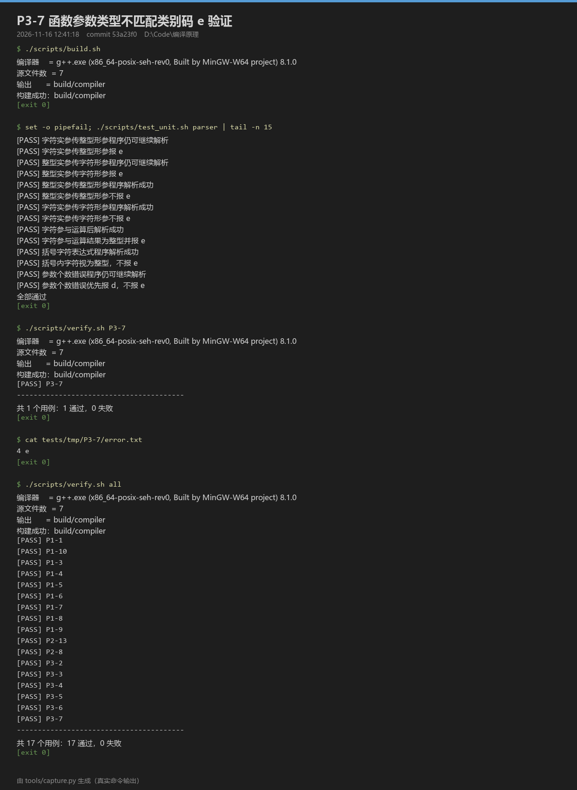

# P3-7 函数参数类型不匹配（类别码 e）

## 1. 目的

为表达式加入类型推导，在函数调用处比较实参类型与形参类型；int/char 不一致输出类别码 `e`。对应 TODO P3-7。

## 2. 环境

- 日期：2026-11-16
- 系统：Windows 11
- 工具链：g++ 8.1.0（MinGW-w64）、Git Bash 2.53.0、Python 3.14
- 代码版本：`53a23f0` 之后的工作区（本功能提交见 `git log --oneline --grep=P3-7`）

## 3. 前置条件

- P3-6 参数个数检查已完成；
- 新增 `tests/cases/P3-7/`（字符形参传整型实参）。

## 4. 复现步骤

1. 构建：

```bash
./scripts/build.sh
```

2. 运行语法/语义单元测试（完整 207 项，截图展示末尾 15 行）：

```bash
set -o pipefail; ./scripts/test_unit.sh parser | tail -n 15
```

3. 运行 P3-7 用例：

```bash
./scripts/verify.sh P3-7
```

4. 查看 `error.txt`：

```bash
cat tests/tmp/P3-7/error.txt
```

5. 回归：

```bash
./scripts/verify.sh all
```

## 5. 预期输出

```text
$ ./scripts/build.sh
编译器    = g++.exe (x86_64-posix-seh-rev0, Built by MinGW-W64 project) 8.1.0
源文件数  = 7
输出      = build/compiler
构建成功：build/compiler
[exit 0]

$ set -o pipefail; ./scripts/test_unit.sh parser | tail -n 15
...（207 项断言，末尾 15 行；完整输出见 run.log 与截图）
全部通过
[exit 0]

$ ./scripts/verify.sh P3-7
...
[PASS] P3-7
共 1 个用例：1 通过，0 失败
[exit 0]

$ cat tests/tmp/P3-7/error.txt
4 e
[exit 0]

$ ./scripts/verify.sh all
...
共 17 个用例：17 通过，0 失败
[exit 0]
```

## 6. 截图



## 7. 备注

### 表达式类型规则

- 因子类型：
  - 整数 → int；
  - 字符字面量 → char；
  - 标识符/数组元素 → 符号表声明类型；
  - 有返回值函数调用 → 函数返回类型；
  - 括号表达式 → int（括号内字符也视为参与运算）。
- 项：单个因子保持类型；出现 `*`/`/` 后为 int。
- 表达式：单个项保持类型；出现一元 `+/-` 或二元 `+/-` 后为 int。

### 调用检查

- 实参个数正确时逐项比较类型；任一 int/char 不一致 → `e`。
- 类型未知（表达式本身有错误）时跳过，避免级联。
- 个数不匹配优先报 `d`，不再报 `e`。
- 错误行号取函数名所在行。

### 用例

```c
void show(char c){
}
void main(){
    show(1);
}
```

`show` 需要 char，实参 `1` 是 int，`error.txt` 为 `4 e`。

### 测试

- 新增 14 项单元测试：char/int 双向不匹配、类型一致、字符参与运算、括号字符、d 优先。
- 语法/语义单元测试累计 207 项；端到端用例 17 个。
