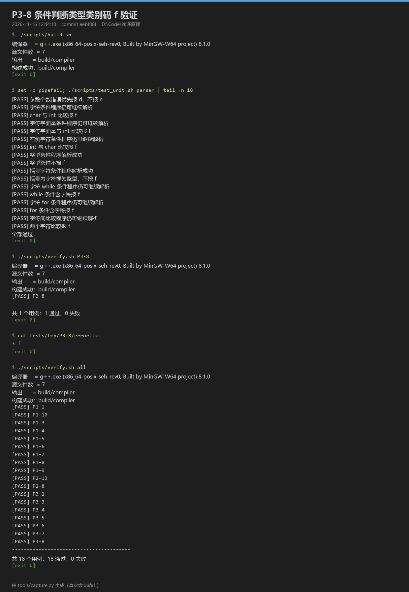

# P3-8 条件判断类型（类别码 f）

## 1. 目的

条件语句/循环语句中的关系比较两侧必须为整型；任一表达式为字符型输出类别码 `f`。对应 TODO P3-8。

## 2. 环境

- 日期：2026-11-16
- 系统：Windows 11
- 工具链：g++ 8.1.0（MinGW-w64）、Git Bash 2.53.0、Python 3.14
- 代码版本：`eebf08f` 之后的工作区（本功能提交见 `git log --oneline --grep=P3-8`）

## 3. 前置条件

- P3-7 表达式类型推导已完成；
- 新增 `tests/cases/P3-8/`（char 与 int 比较）。

## 4. 复现步骤

1. 构建：

```bash
./scripts/build.sh
```

2. 运行语法/语义单元测试（完整 223 项，截图展示末尾 18 行）：

```bash
set -o pipefail; ./scripts/test_unit.sh parser | tail -n 18
```

3. 运行 P3-8 用例：

```bash
./scripts/verify.sh P3-8
```

4. 查看 `error.txt`：

```bash
cat tests/tmp/P3-8/error.txt
```

5. 回归：

```bash
./scripts/verify.sh all
```

## 5. 预期输出

```text
$ ./scripts/build.sh
编译器    = g++.exe (x86_64-posix-seh-rev0, Built by MinGW-W64 project) 8.1.0
源文件数  = 7
输出      = build/compiler
构建成功：build/compiler
[exit 0]

$ set -o pipefail; ./scripts/test_unit.sh parser | tail -n 18
...（223 项断言，末尾 18 行；完整输出见 run.log 与截图）
全部通过
[exit 0]

$ ./scripts/verify.sh P3-8
...
[PASS] P3-8
共 1 个用例：1 通过，0 失败
[exit 0]

$ cat tests/tmp/P3-8/error.txt
3 f
[exit 0]

$ ./scripts/verify.sh all
...
共 18 个用例：18 通过，0 失败
[exit 0]
```

## 6. 截图



## 7. 备注

### 实现要点

- `parse_condition()` 记录关系运算符两侧表达式的类型。
- 任一侧为 `char` → 报 `f`；两侧均为 `int` 或类型未知（表达式已有错误）时不报。
- 行号取关系运算符所在行。
- 括号表达式按整型处理，因此 `(c) == 1` 不报 `f`（与指导书类型转换约定一致）。
- if、while、for 的条件共用该检查。

### 用例

```c
void main(){
    char c;
    if (c == 1) {
    }
}
```

`c` 为 char，与 int 比较，`error.txt` 为 `3 f`。

### 测试

- 新增 16 项单元测试：char/int 双向、字符字面量、字符间比较、括号字符、while/for 条件、整型条件不报错。
- 语法/语义单元测试累计 223 项；端到端用例 18 个。
