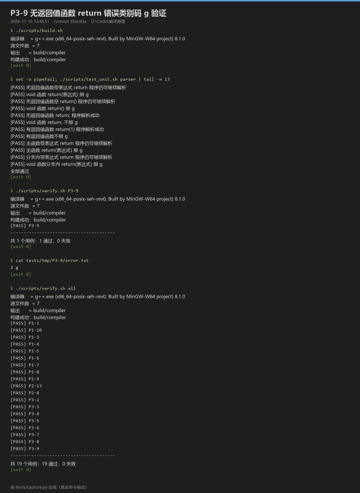

# P3-9 无返回值函数的 return 错误（类别码 g）

## 1. 目的

跟踪当前函数返回类型；在无返回值函数（含主函数）中，`return(表达式);` 或 `return();` 输出类别码 `g`，`return;` 合法。对应 TODO P3-9。

## 2. 环境

- 日期：2026-11-16
- 系统：Windows 11
- 工具链：g++ 8.1.0（MinGW-w64）、Git Bash 2.53.0、Python 3.14
- 代码版本：`35bcd3a` 之后的工作区（本功能提交见 `git log --oneline --grep=P3-9`）

## 3. 前置条件

- P3-8 条件类型检查已完成；
- 新增 `tests/cases/P3-9/`（void 函数 `return(1);`）。

## 4. 复现步骤

1. 构建：

```bash
./scripts/build.sh
```

2. 运行语法/语义单元测试（完整 235 项，截图展示末尾 13 行）：

```bash
set -o pipefail; ./scripts/test_unit.sh parser | tail -n 13
```

3. 运行 P3-9 用例：

```bash
./scripts/verify.sh P3-9
```

4. 查看 `error.txt`：

```bash
cat tests/tmp/P3-9/error.txt
```

5. 回归：

```bash
./scripts/verify.sh all
```

## 5. 预期输出

```text
$ ./scripts/build.sh
编译器    = g++.exe (x86_64-posix-seh-rev0, Built by MinGW-W64 project) 8.1.0
源文件数  = 7
输出      = build/compiler
构建成功：build/compiler
[exit 0]

$ set -o pipefail; ./scripts/test_unit.sh parser | tail -n 13
...（235 项断言，末尾 13 行；完整输出见 run.log 与截图）
全部通过
[exit 0]

$ ./scripts/verify.sh P3-9
...
[PASS] P3-9
共 1 个用例：1 通过，0 失败
[exit 0]

$ cat tests/tmp/P3-9/error.txt
2 g
[exit 0]

$ ./scripts/verify.sh all
...
共 19 个用例：19 通过，0 失败
[exit 0]
```

## 6. 截图



## 7. 备注

### 实现要点

- Parser 记录当前函数返回类型 `current_return_type_`（void/int/char），函数与主函数体解析期间设置，解析结束恢复。
- `parse_return_statement()`：
  - `return;`：合法；
  - `return(表达式);` / `return();`：若当前为 void 函数 → `g`；
  - 行号取 `return` 所在行。
- 主函数按无返回值函数处理。
- 有返回值函数的 return 规则（h）由 P3-10 处理；本阶段不报 `h`。

### 用例

```c
void show(){
    return(1);
}
void main(){
}
```

`show` 无返回值却 `return(1);`，`error.txt` 为 `2 g`。

### 测试

- 新增 12 项单元测试：`return(表达式)`、`return()`、`return;`、主函数、分支内 return。
- 语法/语义单元测试累计 235 项；端到端用例 19 个。
