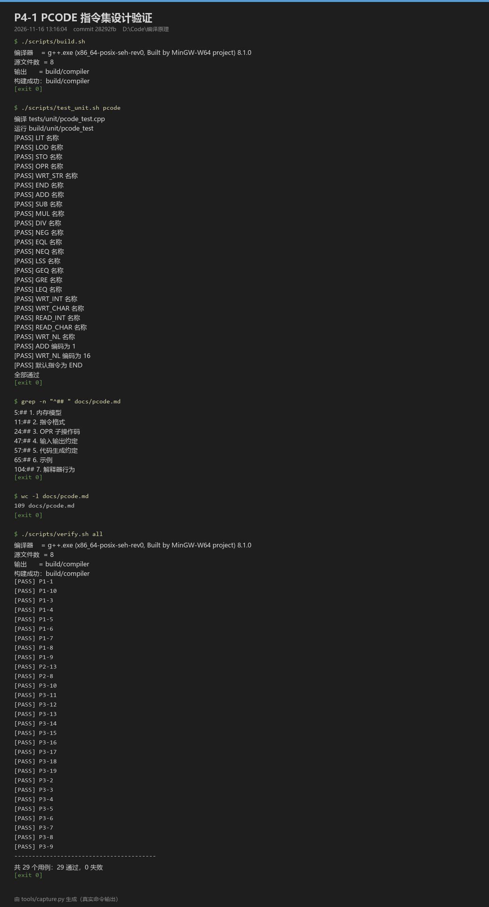

# P4-1 PCODE 指令集设计

## 1. 目的

设计并记录实验四使用的 PCODE 指令集与栈式虚拟机模型，为后续代码生成与解释器提供依据。对应 TODO P4-1。

## 2. 环境

- 日期：2026-11-16
- 系统：Windows 11
- 工具链：g++ 8.1.0（MinGW-w64）、Git Bash 2.53.0、Python 3.14
- 代码版本：`28292fb` 之后的工作区（本功能提交见 `git log --oneline --grep=P4-1`）

## 3. 前置条件

- 实验三已完成（标签 `stage3`）；
- 新增 `docs/pcode.md`、`src/pcode/pcode.h/.cpp` 与 `tests/unit/pcode_test.cpp`。

## 4. 复现步骤

1. 构建（`src/` 下 8 个 `.cpp`）：

```bash
./scripts/build.sh
```

2. 运行 PCODE 定义单元测试：

```bash
./scripts/test_unit.sh pcode
```

3. 查看设计文档章节：

```bash
grep -n "^## " docs/pcode.md
```

4. 回归：

```bash
./scripts/verify.sh all
```

## 5. 预期输出

```text
$ ./scripts/build.sh
编译器    = g++.exe (x86_64-posix-seh-rev0, Built by MinGW-W64 project) 8.1.0
源文件数  = 8
输出      = build/compiler
构建成功：build/compiler
[exit 0]

$ ./scripts/test_unit.sh pcode
编译 tests/unit/pcode_test.cpp
运行 build/unit/pcode_test
[PASS] LIT 名称
...（25 项断言，完整输出见 run.log 与截图）
全部通过
[exit 0]

$ grep -n "^## " docs/pcode.md
（文档章节列表）
[exit 0]

$ wc -l docs/pcode.md
（行数）
[exit 0]

$ ./scripts/verify.sh all
...
共 29 个用例：29 通过，0 失败
[exit 0]
```

## 6. 截图



## 7. 备注

### 指令集

- 基础指令：`LIT n`、`LOD a`、`STO a`、`OPR code`、`WRT_STR "text"`、`END`。
- OPR 子操作码 1–16：算术、关系、整数/字符输出、整数/字符读入、换行。
- 栈式执行；内存为单一定长数组，变量顺序分配地址，常量直接 `LIT`。

### 设计文档

[docs/pcode.md](../../../docs/pcode.md) 包含：

1. 内存模型
2. 指令格式
3. OPR 子操作码表
4. 输入输出约定
5. 代码生成约定
6. 实验四示例程序 → PCODE → 结果
7. 解释器行为

### 测试

- `pcode` 单元测试 25 项：所有操作码/子操作码名称、关键编码、默认指令。
- 全量端到端用例 29 个回归通过。
