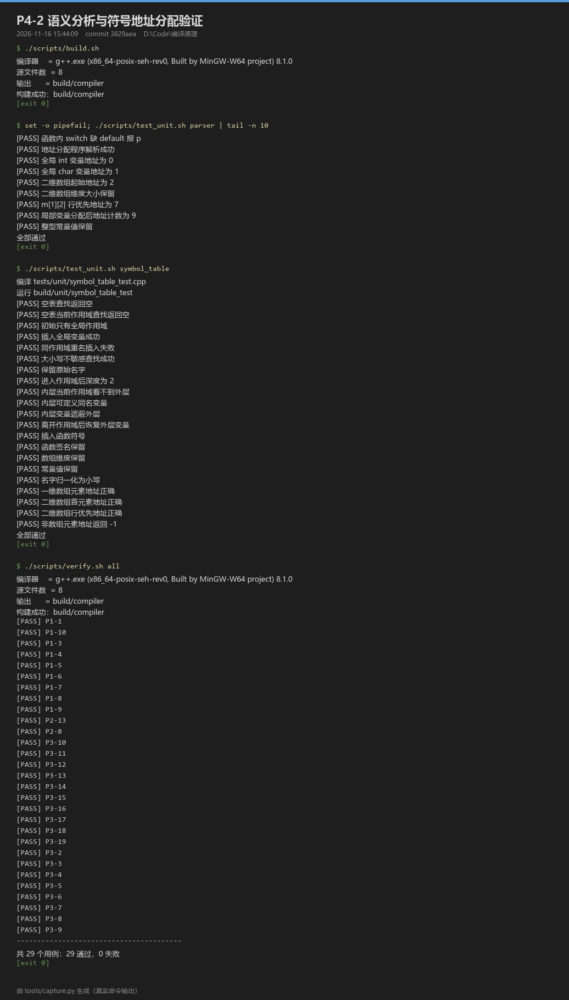

# P4-2 语义分析与符号地址分配

## 1. 目的

为代码生成准备语义信息：符号类型、常量值、变量地址、数组维度与行优先布局。对应 TODO P4-2。

## 2. 环境

- 日期：2026-11-16
- 系统：Windows 11
- 工具链：g++ 8.1.0（MinGW-w64）、Git Bash 2.53.0、Python 3.14
- 代码版本：`3829aea` 之后的工作区（本功能提交见 `git log --oneline --grep=P4-2`）

## 3. 前置条件

- P4-1 PCODE 指令集已完成；
- 扩充 `semantic::Symbol` 与 `Parser` 的地址分配逻辑。

## 4. 复现步骤

1. 构建：

```bash
./scripts/build.sh
```

2. 运行语法/语义单元测试（完整 402 项，截图展示末尾 10 行）：

```bash
set -o pipefail; ./scripts/test_unit.sh parser | tail -n 10
```

3. 运行符号表单元测试：

```bash
./scripts/test_unit.sh symbol_table
```

4. 回归：

```bash
./scripts/verify.sh all
```

## 5. 预期输出

```text
$ ./scripts/build.sh
编译器    = g++.exe (x86_64-posix-seh-rev0, Built by MinGW-W64 project) 8.1.0
源文件数  = 8
输出      = build/compiler
构建成功：build/compiler
[exit 0]

$ ./scripts/test_unit.sh parser | tail -n 10
...
[PASS] 全局 int 变量地址为 0
[PASS] 全局 char 变量地址为 1
[PASS] 二维数组起始地址为 2
[PASS] 二维数组维度大小保留
[PASS] m[1][2] 行优先地址为 7
[PASS] 局部变量分配后地址计数为 9
[PASS] 整型常量值保留
全部通过
[exit 0]

$ ./scripts/test_unit.sh symbol_table
...
[PASS] 二维数组行优先地址正确
[PASS] 非数组元素地址返回 -1
全部通过
[exit 0]

$ ./scripts/verify.sh all
...
共 29 个用例：29 通过，0 失败
[exit 0]
```

## 6. 截图



## 7. 备注

### 符号信息

`semantic::Symbol` 新增：

| 字段 | 含义 |
|---|---|
| `address` | 变量/数组起始地址（常量、函数为 -1） |
| `dimension_sizes` | 数组各维大小（行优先） |

常量同时记录 `has_value`、`int_value`、`char_value`，供代码生成直接生成 `LIT`。

### 地址分配

- 变量按声明顺序分配，每个占 1 个单元；数组占 `各维乘积` 个单元。
- 实验四测试程序无函数与数组调用，使用单一数据区（全局变量 + main 局部变量顺序分配）。
- 数组元素地址：

```text
一维：base + i
二维：base + i * cols + j
```

### 测试用例

源程序：

```c
const int N = -5;
int a;
char b;
int m[2][3];
void main(){
    int c;
}
```

| 符号 | 地址 | 说明 |
|---|---|---|
| N | -1 | 常量，值 -5 |
| a | 0 | int |
| b | 1 | char |
| m | 2 | 2×3，占 6 格 |
| （下一地址） | 8 | main 的局部变量 c |
| （分配后计数） | 9 | 地址分配结束 |

`m[1][2]` 的地址为 `2 + 1×3 + 2 = 7`。

### 测试统计

- 语法/语义单元测试：402 项
- 符号表单元测试：21 项
- 端到端回归：29 个用例
