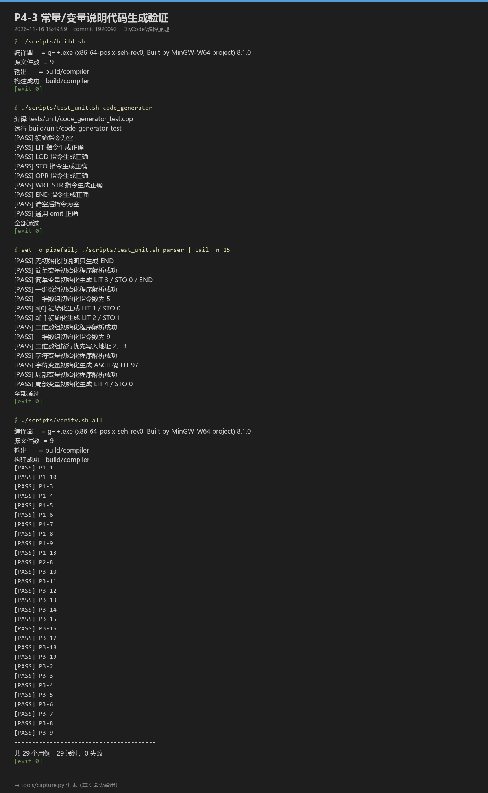

# P4-3 常量说明 / 变量说明的代码生成

## 1. 目的

在语义分析基础上生成说明部分的 PCODE：常量不占运行时代码、变量仅分配地址；带初始化的变量/数组生成 `LIT` + `STO` 序列。对应 TODO P4-3。

## 2. 环境

- 日期：2026-11-16
- 系统：Windows 11
- 工具链：g++ 8.1.0（MinGW-w64）、Git Bash 2.53.0、Python 3.14
- 代码版本：`1920093` 之后的工作区（本功能提交见 `git log --oneline --grep=P4-3`）

## 3. 前置条件

- P4-2 语义分析与地址分配已完成；
- 新增 `src/codegen/code_generator.h/.cpp` 与 `tests/unit/code_generator_test.cpp`。

## 4. 复现步骤

1. 构建（`src/` 下 9 个 `.cpp`）：

```bash
./scripts/build.sh
```

2. 运行代码生成器单元测试：

```bash
./scripts/test_unit.sh code_generator
```

3. 运行语法/代码生成测试（完整 417 项，截图展示末尾 15 行）：

```bash
set -o pipefail; ./scripts/test_unit.sh parser | tail -n 15
```

4. 回归：

```bash
./scripts/verify.sh all
```

## 5. 预期输出

```text
$ ./scripts/build.sh
编译器    = g++.exe (x86_64-posix-seh-rev0, Built by MinGW-W64 project) 8.1.0
源文件数  = 9
输出      = build/compiler
构建成功：build/compiler
[exit 0]

$ ./scripts/test_unit.sh code_generator
...
[PASS] 通用 emit 正确
全部通过
[exit 0]

$ ./scripts/test_unit.sh parser | tail -n 15
...
[PASS] 无初始化的说明只生成 END
[PASS] 简单变量初始化生成 LIT 3 / STO 0 / END
[PASS] 一维数组初始化指令数为 5
[PASS] a[0] 初始化生成 LIT 1 / STO 0
[PASS] a[1] 初始化生成 LIT 2 / STO 1
[PASS] 二维数组初始化指令数为 9
[PASS] 二维数组按行优先写入地址 2、3
[PASS] 字符变量初始化生成 ASCII 码 LIT 97
[PASS] 局部变量初始化生成 LIT 4 / STO 0
全部通过
[exit 0]

$ ./scripts/verify.sh all
...
共 29 个用例：29 通过，0 失败
[exit 0]
```

## 6. 截图



## 7. 备注

### 设计

- 新增 `codegen::CodeGenerator`：收集 `pcode::Instruction`，提供 `emit_lit/lod/sto/opr/wrt_str/end`。
- `Parser` 构造函数新增可选参数 `CodeGenerator*`；非空时自动启用语义分析。
- 常量：仅登记符号与编译期取值，不生成运行时代码。
- 无初始化的变量/数组：不生成运行时代码，仅分配地址。
- 有初始化的变量/数组：按行优先展开，逐元素生成 `LIT value` + `STO address`。
- `parse_program()` 成功时追加 `END`。

### 生成示例

| 源程序 | PCODE |
|---|---|
| `int a = 3;` | `LIT 3` `STO 0` |
| `int a[2] = {1, 2};` | `LIT 1 STO 0` `LIT 2 STO 1` |
| `int m[2][2] = {{1,2},{3,4}};` | `LIT 1 STO 0` … `LIT 4 STO 3` |
| `char c = 'a';` | `LIT 97` `STO 0` |

### 测试

- `code_generator` 单元测试 9 项。
- 解析器测试新增 14 项；累计 417 项。
- 端到端回归 29 个用例通过。

### 后续

- P4-4 生成表达式与赋值代码；
- P4-5 生成读写语句代码；
- P4-6 增加 `--gen` 驱动与解释器。
