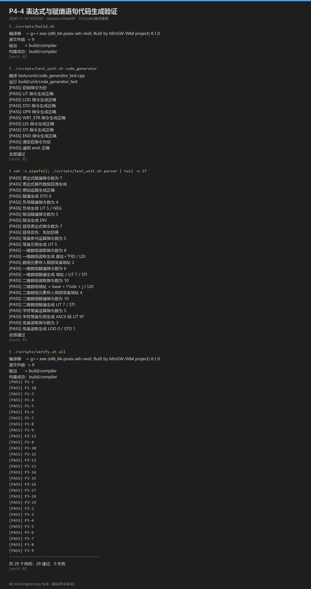

# P4-4 表达式与赋值语句代码生成

## 1. 目的

采用后序方式生成表达式的 PCODE，并支持赋值语句（含一元负号、乘除、括号、常量/变量引用与数组元素）。对应 TODO P4-4。

## 2. 环境

- 日期：2026-11-16
- 系统：Windows 11
- 工具链：g++ 8.1.0（MinGW-w64）、Git Bash 2.53.0、Python 3.14
- 代码版本：`e1beb99` 之后的工作区（本功能提交见 `git log --oneline --grep=P4-4`）

## 3. 前置条件

- P4-3 说明语句代码生成已完成；
- PCODE 新增 `LDI` / `STI` 间接取数/存数指令。

## 4. 复现步骤

1. 构建：

```bash
./scripts/build.sh
```

2. 运行代码生成器单元测试：

```bash
./scripts/test_unit.sh code_generator
```

3. 运行语法/代码生成测试（完整 443 项，截图展示末尾 27 行）：

```bash
set -o pipefail; ./scripts/test_unit.sh parser | tail -n 27
```

4. 回归：

```bash
./scripts/verify.sh all
```

## 5. 预期输出

```text
$ ./scripts/build.sh
编译器    = g++.exe (x86_64-posix-seh-rev0, Built by MinGW-W64 project) 8.1.0
源文件数  = 9
输出      = build/compiler
构建成功：build/compiler
[exit 0]

$ ./scripts/test_unit.sh code_generator
...
[PASS] LDI 指令生成正确
[PASS] STI 指令生成正确
全部通过
[exit 0]

$ ./scripts/test_unit.sh parser | tail -n 27
...
[PASS] 乘加运算生成正确
[PASS] 负号生成 LIT 5 / NEG
[PASS] 除法生成 DIV
[PASS] 括号优先：先加后乘
[PASS] 常量引用生成 LIT 5
[PASS] 一维数组读取生成 基址+下标 / LDI
[PASS] 二维数组地址 = base + i*cols + j / LDI
[PASS] 二维数组赋值生成 LIT 7 / STI
[PASS] 字符常量引用生成 ASCII 码 LIT 97
[PASS] 变量读取生成 LOD 0 / STO 1
全部通过
[exit 0]

$ ./scripts/verify.sh all
...
共 29 个用例：29 通过，0 失败
[exit 0]
```

## 6. 截图



## 7. 备注

### 生成规则

| 语法成分 | PCODE |
|---|---|
| 整型/字符常量 | `LIT 值`（字符取 ASCII） |
| 常量名 | `LIT 常量值` |
| 变量 | `LOD 地址` |
| `a + b` / `a - b` | 两侧代码 + `OPR ADD/SUB` |
| `a * b` / `a / b` | 两侧代码 + `OPR MUL/DIV` |
| `-a` | a 的代码 + `OPR NEG` |
| `(a)` | a 的代码（不额外生成） |
| `a[i]` | `LIT base` + i + `ADD` + `LDI` |
| `m[i][j]` | `LIT base` + i + `LIT cols` + `MUL` + `ADD` + j + `ADD` + `LDI` |
| 变量赋值 | 右侧代码 + `STO 地址` |
| 数组元素赋值 | 地址代码 + 右侧代码 + `STI` |

### PCODE 扩展

新增：

- `LDI`：弹出地址，压入 `mem[地址]`；
- `STI`：弹出值 v、地址 a，令 `mem[a] = v`。

已同步更新 `docs/pcode.md`。

### 指令序列示例

`x = 2 + 3 * 4;`（x 地址 0）：

```text
LIT 2
LIT 3
LIT 4
OPR MUL
OPR ADD
STO 0
END
```

`x = m[1][0];`（m 地址 0，2×2；x 地址 4）：

```text
LIT 0
LIT 1
LIT 2
OPR MUL
OPR ADD
LIT 0
OPR ADD
LDI
STO 4
END
```

### 测试

- 解析器测试新增 26 项，累计 443 项；
- PCODE 测试 27 项、代码生成器测试 11 项；
- 端到端回归 29 个用例通过。
