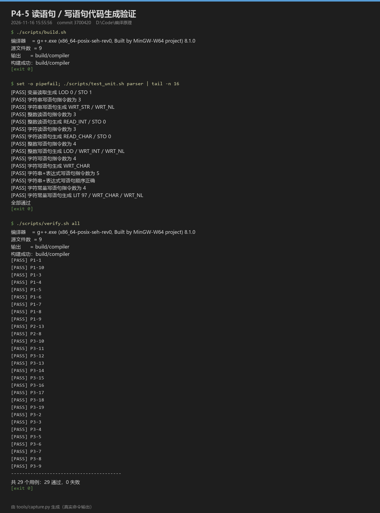

# P4-5 读语句 / 写语句代码生成

## 1. 目的

生成 `scanf` 与 `printf` 的 PCODE：读入按变量类型选择 `READ_INT/READ_CHAR`，输出覆盖 printf 三种形式，并按 char/int 选择输出方式、每条写语句结尾换行。对应 TODO P4-5。

## 2. 环境

- 日期：2026-11-16
- 系统：Windows 11
- 工具链：g++ 8.1.0（MinGW-w64）、Git Bash 2.53.0、Python 3.14
- 代码版本：`3700420` 之后的工作区（本功能提交见 `git log --oneline --grep=P4-5`）

## 3. 前置条件

- P4-4 表达式与赋值代码生成已完成；
- 解释器尚未实现（P4-6）；本功能只验证指令序列。

## 4. 复现步骤

1. 构建：

```bash
./scripts/build.sh
```

2. 运行语法/代码生成测试（完整 457 项，截图展示末尾 16 行）：

```bash
set -o pipefail; ./scripts/test_unit.sh parser | tail -n 16
```

3. 回归：

```bash
./scripts/verify.sh all
```

## 5. 预期输出

```text
$ ./scripts/build.sh
编译器    = g++.exe (x86_64-posix-seh-rev0, Built by MinGW-W64 project) 8.1.0
源文件数  = 9
输出      = build/compiler
构建成功：build/compiler
[exit 0]

$ ./scripts/test_unit.sh parser | tail -n 16
...
[PASS] 字符串写语句生成 WRT_STR / WRT_NL
[PASS] 整数读语句生成 READ_INT / STO 0
[PASS] 字符读语句生成 READ_CHAR / STO 0
[PASS] 整数写语句生成 LOD / WRT_INT / WRT_NL
[PASS] 字符写语句生成 WRT_CHAR
[PASS] 字符串+表达式写语句顺序正确
[PASS] 字符常量写语句生成 LIT 97 / WRT_CHAR / WRT_NL
全部通过
[exit 0]

$ ./scripts/verify.sh all
...
共 29 个用例：29 通过，0 失败
[exit 0]
```

## 6. 截图



## 7. 备注

### 读语句

| 源程序 | PCODE |
|---|---|
| `scanf(x)`，x 为 int | `OPR READ_INT` + `STO addr` |
| `scanf(c)`，c 为 char | `OPR READ_CHAR` + `STO addr` |

- 常量或数组作为 scanf 参数不生成读入代码（P3-12 已报错）。

### 写语句

| 形式 | PCODE |
|---|---|
| `printf("s")` | `WRT_STR "s"` + `WRT_NL` |
| `printf("s", e)` | `WRT_STR "s"` + e 的代码 + `WRT_INT/CHAR` + `WRT_NL` |
| `printf(e)` | e 的代码 + `WRT_INT/CHAR` + `WRT_NL` |

- 输出类型由表达式类型决定：char → `WRT_CHAR`，其余 → `WRT_INT`。
- 字符串常量原样保存（无转义），直接作为 `WRT_STR` 的文本。
- 字符串先于表达式生成，保证输出顺序为 `s` 再值。

### 测试

- 解析器测试新增 16 项，累计 457 项；
- 回归 29 个用例通过。

### 后续

- P4-6 实现解释器，读取标准输入并执行上述指令，写 `pcoderesult.txt`。
