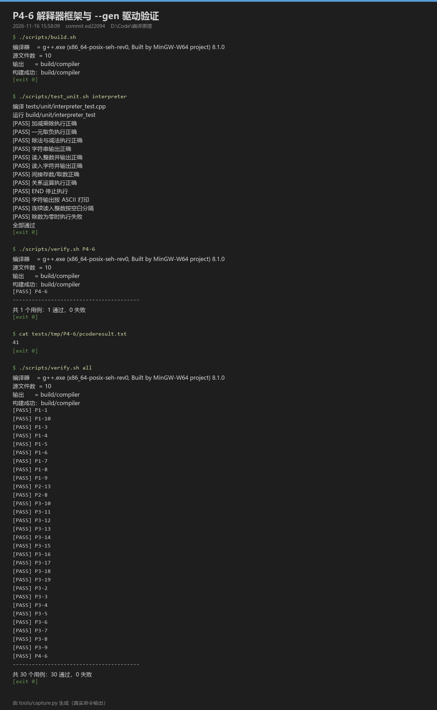

# P4-6 解释器框架与 `--gen` 驱动

## 1. 目的

实现 PCODE 栈式解释器与 `--gen` 驱动：从标准输入读数据、顺序执行指令、结果写 `pcoderesult.txt`。对应 TODO P4-6。

## 2. 环境

- 日期：2026-11-16
- 系统：Windows 11
- 工具链：g++ 8.1.0（MinGW-W64）、Git Bash 2.53.0、Python 3.14
- 代码版本：`ed22094` 之后的工作区（本功能提交见 `git log --oneline --grep=P4-6`）

## 3. 前置条件

- P4-5 读写代码生成已完成；
- 新增 `src/pcode/interpreter.h/.cpp`、`tests/unit/interpreter_test.cpp` 与 `src/main.cpp` 的 `--gen` 分支。

## 4. 复现步骤

1. 构建（`src/` 下 10 个 `.cpp`）：

```bash
./scripts/build.sh
```

2. 运行解释器单元测试：

```bash
./scripts/test_unit.sh interpreter
```

3. 运行 P4-6 端到端用例（读入 20，计算 `a * 2 + 1`）：

```bash
./scripts/verify.sh P4-6
```

4. 查看结果：

```bash
cat tests/tmp/P4-6/pcoderesult.txt
```

5. 回归：

```bash
./scripts/verify.sh all
```

## 5. 预期输出

```text
$ ./scripts/build.sh
编译器    = g++.exe (x86_64-posix-seh-rev0, Built by MinGW-W64 project) 8.1.0
源文件数  = 10
输出      = build/compiler
构建成功：build/compiler
[exit 0]

$ ./scripts/test_unit.sh interpreter
...
[PASS] 连续读入整数按空白分隔
[PASS] 除数为零时执行失败
全部通过
[exit 0]

$ ./scripts/verify.sh P4-6
...
[PASS] P4-6
共 1 个用例：1 通过，0 失败
[exit 0]

$ cat tests/tmp/P4-6/pcoderesult.txt
41
[exit 0]

$ ./scripts/verify.sh all
...
共 30 个用例：30 通过，0 失败
[exit 0]
```

## 6. 截图



## 7. 备注

### 解释器

- 内存：固定 4096 个整数单元，按符号表分配的地址访问。
- 操作数栈：`LIT/LOD/LDI/READ` 压栈；`STO/STI/WRT` 弹栈。
- 支持全部指令：`LIT/LOD/STO/OPR/WRT_STR/LDI/STI/END`。
- 关系运算、`NEG`、`DIV` 已实现；除数为零时报告执行错误并退出。
- 输入：
  - `READ_INT` 按空白跳过并读取整数；
  - `READ_CHAR` 跳过空白后读取一个字符。
- 输出：`WRT_INT` 输出整数，`WRT_CHAR` 按 ASCII 输出字符，`WRT_NL` 换行。

### `--gen` 驱动

```text
compiler --gen
```

1. 读取 `testfile.txt`；
2. 以代码生成模式解析（自动启用语义分析）；
3. 有词法/语法/语义错误则退出码 1，不生成结果；
4. 否则解释执行生成的 PCODE，标准输入来自 stdin，结果写 `pcoderesult.txt`。

### 用例

```c
int a;
void main(){
    scanf(a);
    a = a * 2 + 1;
    printf(a);
}
```

输入 `20`，输出 `41`。

### 测试

- 解释器单元测试 12 项；
- 端到端用例新增 P4-6；全量回归 30 个用例通过。
