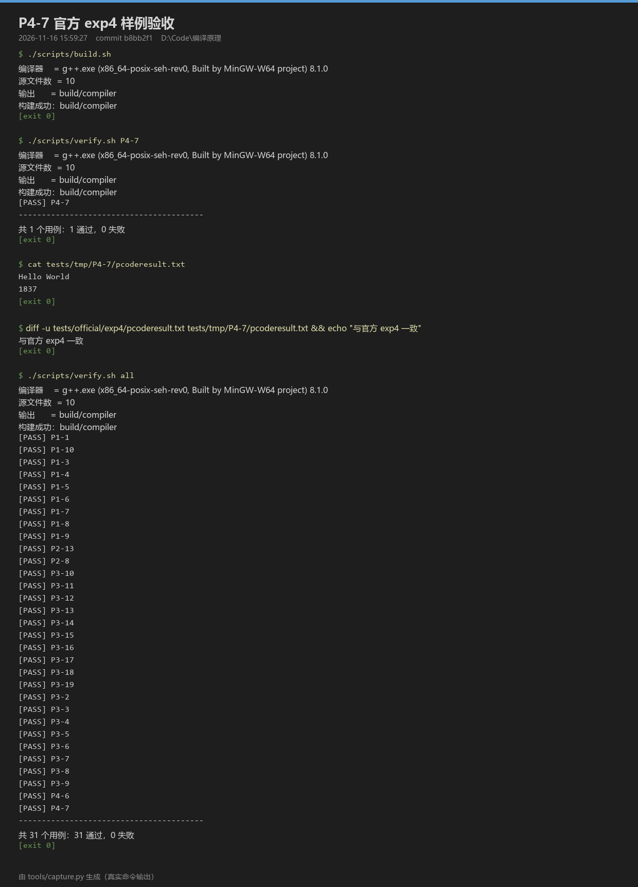

# P4-7 官方 exp4 样例

## 1. 目的

用指导书官方 exp4 样例验收代码生成与解释执行：`pcoderesult.txt` 恰为 `Hello World` 与 `1837` 两行。对应 TODO P4-7。

## 2. 环境

- 日期：2026-11-16
- 系统：Windows 11
- 工具链：g++ 8.1.0（MinGW-W64）、Git Bash 2.53.0、Python 3.14
- 代码版本：`b8bb2f1` 之后的工作区（本功能提交见 `git log --oneline --grep=P4-7`）

## 3. 前置条件

- P4-6 解释器与 `--gen` 驱动已完成；
- 新增 `tests/cases/P4-7/`：输入、stdin、期望输出均复制自官方 exp4。

## 4. 复现步骤

1. 构建：

```bash
./scripts/build.sh
```

2. 运行 P4-7 用例：

```bash
./scripts/verify.sh P4-7
```

3. 查看结果：

```bash
cat tests/tmp/P4-7/pcoderesult.txt
```

4. 与官方输出比对：

```bash
diff -u tests/official/exp4/pcoderesult.txt tests/tmp/P4-7/pcoderesult.txt && echo "与官方 exp4 一致"
```

5. 回归：

```bash
./scripts/verify.sh all
```

## 5. 预期输出

```text
$ ./scripts/build.sh
编译器    = g++.exe (x86_64-posix-seh-rev0, Built by MinGW-W64 project) 8.1.0
源文件数  = 10
输出      = build/compiler
构建成功：build/compiler
[exit 0]

$ ./scripts/verify.sh P4-7
...
[PASS] P4-7
共 1 个用例：1 通过，0 失败
[exit 0]

$ cat tests/tmp/P4-7/pcoderesult.txt
Hello World
1837
[exit 0]

$ diff -u tests/official/exp4/pcoderesult.txt tests/tmp/P4-7/pcoderesult.txt && echo "与官方 exp4 一致"
与官方 exp4 一致
[exit 0]

$ ./scripts/verify.sh all
...
共 31 个用例：31 通过，0 失败
[exit 0]
```

## 6. 截图



## 7. 备注

### 官方样例

```c
int test;
void main(){
    printf("Hello World");
    scanf(test);
    printf(test);
}
```

标准输入：

```text
1837
```

### 生成的 PCODE

```text
WRT_STR "Hello World"
OPR WRT_NL
OPR READ_INT
STO 0
LOD 0
OPR WRT_INT
OPR WRT_NL
END
```

### 执行结果

```text
Hello World
1837
```

与 `tests/official/exp4/pcoderesult.txt` 逐字节一致。

### 用例来源

`tests/cases/P4-7/` 的 `testfile.txt`、`stdin.txt`、`expect.txt` 均复制自官方 exp4，未修改。
