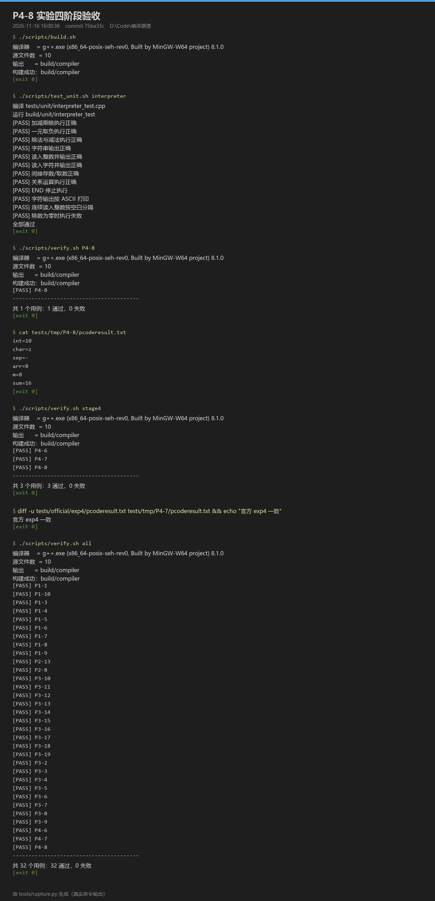

# P4-8 实验四阶段验收

## 1. 目的

按 AGENTS.md §6.2 完成实验四（代码生成）阶段验收：官方 exp4 通过、读/写/赋值/表达式组合用例正确、PCODE 不混入结果文件，并打标签 `stage4`。对应 TODO P4-8。

## 2. 环境

- 日期：2026-11-16
- 系统：Windows 11
- 工具链：g++ 8.1.0（MinGW-W64）、Git Bash 2.53.0、Python 3.14
- 代码版本：`75ba33c` 之后的工作区（本功能提交见 `git log --oneline --grep=P4-8`）

## 3. 前置条件

- P4-1～P4-7 全部完成；
- 新增 `tests/cases/P4-8/`（常量/变量/读写/赋值/数组组合）。

## 4. 复现步骤

1. 构建：

```bash
./scripts/build.sh
```

2. 运行解释器单元测试：

```bash
./scripts/test_unit.sh interpreter
```

3. 运行组合用例：

```bash
./scripts/verify.sh P4-8
```

4. 查看结果：

```bash
cat tests/tmp/P4-8/pcoderesult.txt
```

5. 运行实验四全部用例：

```bash
./scripts/verify.sh stage4
```

6. 与官方 exp4 比对：

```bash
diff -u tests/official/exp4/pcoderesult.txt tests/tmp/P4-7/pcoderesult.txt && echo "官方 exp4 一致"
```

7. 全量回归：

```bash
./scripts/verify.sh all
```

## 5. 预期输出

```text
$ ./scripts/build.sh
编译器    = g++.exe (x86_64-posix-seh-rev0, Built by MinGW-W64 project) 8.1.0
源文件数  = 10
输出      = build/compiler
构建成功：build/compiler
[exit 0]

$ ./scripts/test_unit.sh interpreter
...
全部通过
[exit 0]

$ ./scripts/verify.sh P4-8
[PASS] P4-8
[exit 0]

$ cat tests/tmp/P4-8/pcoderesult.txt
int=10
char=z
sep=-
arr=8
m=8
sum=16
[exit 0]

$ ./scripts/verify.sh stage4
...
共 3 个用例：3 通过，0 失败
[exit 0]

$ diff -u tests/official/exp4/pcoderesult.txt tests/tmp/P4-7/pcoderesult.txt && echo "官方 exp4 一致"
官方 exp4 一致
[exit 0]

$ ./scripts/verify.sh all
...
共 32 个用例：32 通过，0 失败
[exit 0]
```

## 6. 截图



## 7. 备注

### 组合用例

```c
const int K = 3;
const char SEP = '-';
int a;
char ch;
int arr[3];
int m[2][2] = {{1, 2}, {3, 4}};
void main(){
    scanf(a);
    scanf(ch);
    arr[0] = a + K * 2;
    arr[1] = (a - 1) / 2;
    arr[2] = -arr[0] + arr[1];
    m[1][1] = arr[0] + arr[1] + arr[2];
    printf("int=", a);
    printf("char=", ch);
    printf("sep=", SEP);
    printf("arr=", arr[0] + arr[1] + arr[2]);
    printf("m=", m[1][1]);
    printf("sum=", arr[0] + arr[1] + arr[2] + m[1][1]);
}
```

输入：

```text
10
z
```

计算：

| 表达式 | 值 |
|---|---|
| `arr[0] = a + K * 2` | 16 |
| `arr[1] = (a - 1) / 2` | 4 |
| `arr[2] = -arr[0] + arr[1]` | -12 |
| `m[1][1] = arr[0]+arr[1]+arr[2]` | 8 |
| `arr[0]+arr[1]+arr[2]` | 8 |
| `sum` | 16 |

覆盖：

- 常量（int/char）引用；
- 全局变量、char 变量、一维/二维数组及初始化；
- `scanf` 读 int 与 char（跨行读取）；
- 赋值与数组元素赋值；
- 表达式：乘加、括号、整除、一元负号、数组元素参与运算；
- printf 三种形式、char/int 输出、逐句换行。

### §6.2 阶段验收 checklist

| 条目 | 结果 | 证据 |
|---|---|---|
| 官方 exp4 结果为 `Hello World` / `1837` | ✅ | P4-7，diff 无差异 |
| 标准输入每项一行；int/char 均正确处理 | ✅ | P4-8 连续读入 10 与 z |
| printf 三种形式正确；char 字符、int 整数；每句换行 | ✅ | P4-8 六条输出 |
| 赋值与表达式（负号、乘除、括号）正确 | ✅ | P4-8 计算结果 |
| PCODE 不混入结果文件 | ✅ | `pcoderesult.txt` 仅程序输出 |

### 阶段标签

```bash
git tag -a stage4 -m "实验四 代码生成 阶段验收通过（P4-1～P4-8）"
git push origin stage4
```

### 测试规模

- 解释器单元测试：12 项
- 实验四端到端用例：3 个（P4-6、P4-7、P4-8）
- 全量端到端用例：32 个
