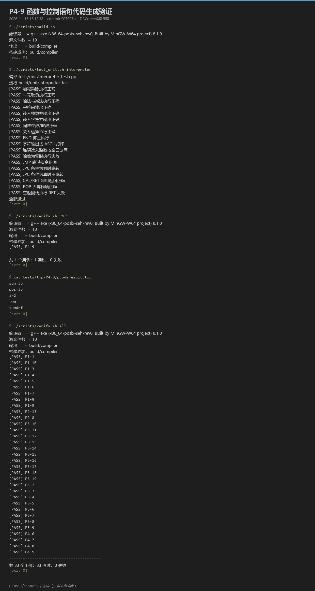

# P4-9 函数与控制语句代码生成（可选扩展）

## 1. 目的

在实验四基础上扩展代码生成：函数定义/调用/返回、if/else、while、for、switch。对应可选 TODO P4-9。

## 2. 环境

- 日期：2026-11-16
- 系统：Windows 11
- 工具链：g++ 8.1.0（MinGW-W64）、Git Bash 2.53.0、Python 3.14
- 代码版本：`507997b` 之后的工作区（本功能提交见 `git log --oneline --grep=P4-9`）

## 3. 前置条件

- P4-8 实验四阶段验收已完成（`stage4`）；
- PCODE 新增 `JMP/JPC/CAL/RET` 与 `OPR POP`。

## 4. 复现步骤

1. 构建：

```bash
./scripts/build.sh
```

2. 运行解释器单元测试：

```bash
./scripts/test_unit.sh interpreter
```

3. 运行 P4-9 组合用例：

```bash
./scripts/verify.sh P4-9
```

4. 查看结果：

```bash
cat tests/tmp/P4-9/pcoderesult.txt
```

5. 回归：

```bash
./scripts/verify.sh all
```

## 5. 预期输出

```text
$ ./scripts/build.sh
编译器    = g++.exe (x86_64-posix-seh-rev0, Built by MinGW-W64 project) 8.1.0
源文件数  = 10
输出      = build/compiler
构建成功：build/compiler
[exit 0]

$ ./scripts/test_unit.sh interpreter
...
[PASS] 空返回栈执行 RET 失败
全部通过
[exit 0]

$ ./scripts/verify.sh P4-9
[PASS] P4-9
[exit 0]

$ cat tests/tmp/P4-9/pcoderesult.txt
sum=33
pos=33
i=2
two
sumdef
[exit 0]

$ ./scripts/verify.sh all
...
共 33 个用例：33 通过，0 失败
[exit 0]
```

## 6. 截图



## 7. 备注

### 新增指令

| 指令 | 含义 |
|---|---|
| `JMP t` | 无条件跳转 |
| `JPC t` | 弹出条件，为 0 跳转 |
| `CAL t` | 调用函数，返回地址入调用栈 |
| `RET` | 返回 |
| `OPR POP` | 丢弃栈顶（有返回值调用作为语句时） |

### 实现要点

- 函数定义处生成 `JMP` 跳过函数体，入口为跳过指令的下一条；函数尾生成 `RET`。
- 实参在调用前存入被调函数的参数地址；参数/局部变量使用静态地址。
- 语言只允许调用已定义函数，不可能递归，因此静态帧是安全的。
- 有返回值函数在 `RET` 前把返回值留在栈顶；无返回值调用语句在 `CAL` 后 `POP` 丢弃多余值。
- 控制语句：
  - if/else 使用 `JPC` + `JMP`；
  - while 使用回跳；
  - for 的步长代码在解析时暂存，循环体之后再生效；
  - switch 用临时单元保存表达式，逐 case `EQL` + `JPC`，命中后 `JMP` 到末尾，不贯穿。

### 用例

```c
int add(int x, int y){
    return(x + y);
}
void print_if(int n){
    if (n > 0) {
        printf("pos=", n);
    } else {
        printf("nonpos=", n);
    }
}
void main(){
    int i;
    int sum;
    sum = 0;
    for (i = 0; i < 3; i = i + 1) {
        sum = sum + add(i, 10);
    }
    printf("sum=", sum);
    print_if(sum);
    i = 0;
    while (i < 2) {
        i = i + 1;
    }
    printf("i=", i);
    switch (i) {
        case 1:
            printf("one");
        case 2:
            printf("two");
        default:
            printf("other");
    }
    switch (sum) {
        case 1:
            printf("one");
        default:
            printf("sumdef");
    }
}
```

结果：

```text
sum=33
pos=33
i=2
two
sumdef
```

### 调试

设置环境变量 `DUMP_PCODE=1` 可在 stderr 看到生成的 PCODE（默认关闭，不影响结果文件）。

### 测试

- 解析器测试 466 项（新增函数/控制流端到端代码生成 9 项）；
- 解释器测试 18 项（新增 JMP/JPC/CAL/RET/POP 6 项）；
- PCODE 测试 33 项；
- 端到端用例 33 个。
